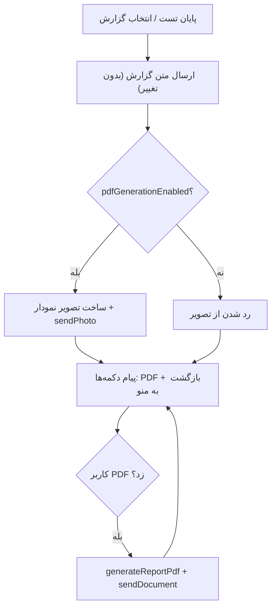

# نمودار و PDF در ربات (سطح ۲ و ۳)

## هدف

گزارش ربات علاوه بر متن، **تصویر نمودار عنکبوتی** (سطح ۲) و **فایل PDF کامل** (سطح ۳) هم بدهد. همه در لایه مسنجر + یک صفحه‌ی رندر داخلی؛ نسخه وب و APIها دست‌نخورده.

## اصول

- **in-process:** [`messenger.service.ts`](src/modules/messenger/messenger.service.ts) مستقیم سرویس گزارش را صدا می‌زند؛ نیازی به HTTP نیست.
- **گیت با فلگ موجود:** هر دو قابلیت به Chromium نیاز دارند، پس با همان `PDF_GENERATION_ENABLED` (`env.pdfGenerationEnabled`) گیت می‌شوند.
- **fallback امن:** اگر تولید تصویر/PDF خطا داد یا فلگ خاموش بود، گزارش متنی موجود بدون تغییر ارسال می‌شود و ربات کرش نمی‌کند.
- **دسترسی:** تصویر و PDF از طریق `resultToken` همان ارزیابی ساخته می‌شوند (مثل صفحه print).

## تصمیم‌های UX (قابل تغییر)

- **نمودار:** خودکار بعد از متن گزارش ارسال می‌شود (همه‌کاربری).
- **PDF:** پشت دکمه «📁 دریافت گزارش کامل (PDF)» تا فقط در صورت درخواست ساخته شود.
- **منبع تصویر:** رندر داخلی Playwright (نه QuickChart) تا داده به سرویس ثالث نرود و برندینگ یکدست بماند.

## جریان



---

## بخش A — گسترش BotClient و کلاینت‌ها (پایه‌ی هر دو سطح)

### A1. اینترفیس
در [`bot-client.types.ts`](src/modules/messenger/bot/bot-client.types.ts) دو متد اضافه شود:

```typescript
sendPhoto(params: {
  chatId: string;
  photo: Buffer;
  filename?: string;
  caption?: string;
  replyMarkup?: ReplyMarkup;
}): Promise<{ messageId: string }>;

sendDocument(params: {
  chatId: string;
  document: Buffer;
  filename: string;
  caption?: string;
  replyMarkup?: ReplyMarkup;
}): Promise<{ messageId: string }>;
```

### A2. پیاده‌سازی multipart
در [`telegram-api.client.ts`](src/modules/messenger/bot/telegram-api.client.ts) یک `callApiMultipart` اضافه شود که با `FormData` + `Blob` (سراسری در Node 20+) فایل را می‌فرستد:
- فیلدها: `chat_id`, `photo`/`document` (Blob از Buffer)، `caption`، و `reply_markup` به‌صورت `JSON.stringify(buildReplyMarkup(...))`.
- endpointها: `sendPhoto` و `sendDocument` (هم تلگرام هم بله همین مسیر Bot API را دارند).
- `buildReplyMarkup` موجود بدون تغییر استفاده می‌شود.

### A3. dev client
در [`dev.client.ts`](src/modules/messenger/bot/dev.client.ts) دو متد جدید فقط لاگ بزنند (طول Buffer را چاپ کنند) و `messageId` برگردانند تا تست‌ها و حالت بدون توکن نشکنند.

---

## بخش B — سطح ۲: تصویر نمودار عنکبوتی

### B1. ماژول مشترک مرورگر
استخراج `getBrowser`/`resetBrowserForTests` از [`report-pdf.service.ts`](src/modules/report/report-pdf.service.ts) به فایل جدید `src/modules/report/playwright-browser.ts` تا هم PDF و هم تصویر از یک instance استفاده کنند. `report-pdf.service.ts` از آن import کند (رفتار فعلی حفظ می‌شود).

### B2. صفحه‌ی نمودار مستقل
مسیر جدید `src/app/report/[reportId]/chart/page.tsx` + `layout.tsx`:
- منطق دسترسی و بارگذاری دقیقاً مثل [`print/page.tsx`](src/app/report/[reportId]/print/page.tsx) (token/session، `getReport`).
- فقط بلوک radar از `reportSpec` را در یک کانتینر با اندازه‌ی ثابت (مثلاً `800x800`، پس‌زمینه سفید، RTL) با کامپوننت [`SpiderChart`](src/components/charts/SpiderChart.tsx) رندر کند.
- [`PrintReadyMarker`](src/components/report/PrintReadyMarker.tsx) را برای سیگنال آماده‌بودن قرار دهد.

### B3. سرویس تصویر
فایل جدید `src/modules/report/report-image.service.ts`:
- `generateReportChartImage(reportId, access): Promise<Buffer>`
- ساختار مثل `generateReportPdf`: گیت با `env.pdfGenerationEnabled`، ساخت URL نمودار با token، `page.goto` + `waitForSelector("html[data-print-ready='true']")`، سپس `page.screenshot({ type: "png" })` روی عنصر نمودار (یا `clip` با ابعاد ثابت). خروجی `Buffer`.

### B4. اتصال در ربات
در [`sendAssessmentReportInChat`](src/modules/messenger/messenger.service.ts) بعد از `sendLongText`:
- اگر `env.pdfGenerationEnabled` و `assessment.report?.id` موجود بود، در `try/catch`: `generateReportChartImage(reportId, { token: assessment.resultToken })` سپس `client.sendPhoto({ chatId, photo, caption: "نقشه ۱۶ دامنه فروش" })`.
- خطا فقط لاگ شود؛ جریان ادامه یابد.

### B5. (اختیاری) fallback متنی
افزودن یک تابع میله‌ی یونیکد به [`messenger-result.formatter.ts`](src/modules/messenger/messenger-result.formatter.ts) که وقتی تصویر ساخته نشد، رتبه‌بندی دامنه‌ها را متنی نشان دهد. اگر بخواهیم ساده نگه داریم، این بخش را حذف می‌کنیم.

---

## بخش C — سطح ۳: خروجی PDF

### C1. دکمه و callback
در [`messenger-menu.ts`](src/modules/messenger/messenger-menu.ts):
- ثابت `PDF_CALLBACK_PREFIX = "pdf:"` + `isPdfCallback` + `parsePdfCallback` (مثل `report:`؛ `pdf:{assessmentId}` زیر ۶۴ بایت است).
- تابع `buildReportActionsRows(assessmentId, { pdfEnabled })` که ردیف «📁 دریافت گزارش کامل (PDF)» (فقط اگر فعال) + «↩️ بازگشت به منو» را می‌سازد.

### C2. جایگزینی پیام دکمه‌ی پایانی
در [`sendAssessmentReportInChat`](src/modules/messenger/messenger.service.ts) پیام پایانی «بازگشت به منو» با `buildReportActionsRows(assessmentId, { pdfEnabled: env.pdfGenerationEnabled })` جایگزین شود تا دکمه PDF کنار بازگشت بیاید.

### C3. هندلر PDF
در [`handleCallback`](src/modules/messenger/messenger.service.ts) شاخه‌ی جدید برای `isPdfCallback`:
- `answerCallbackQuery` + پیام «در حال آماده‌سازی فایل PDF...».
- بررسی مالکیت (`assessment.userId === conversation.userId`) و `status === "completed"` مثل تابع گزارش.
- `generateReportPdf(assessment.report.id, { token: assessment.resultToken })` سپس `client.sendDocument({ chatId, document, filename: "sales-health-report.pdf", caption })`.
- در `try/catch`؛ خطا → پیام «تولید PDF ناموفق بود، دوباره تلاش کنید» + دکمه بازگشت.

---

## بخش D — تست

- [`src/tests/messenger/messenger-menu.test.ts`](src/tests/messenger/messenger-menu.test.ts): تست `isPdfCallback`/`parsePdfCallback` و `buildReportActionsRows` (نمایش/عدم‌نمایش دکمه PDF بر اساس فلگ، طول callback زیر ۶۴).
- یک unit test برای `callApiMultipart` (mock کردن `fetch`) که فرم‌دیتای درست ساخته می‌شود.
- تست اینتگریشن جریان گزارش: با فلگ خاموش فقط متن؛ با dev client مطمئن شویم مسیر sendPhoto/sendDocument بدون خطا صدا زده می‌شود (نیازی به Chromium واقعی در تست نیست چون سرویس‌ها mock می‌شوند).

## ریسک‌ها

- **سازگاری بله:** `sendPhoto`/`sendDocument` بله باید عملاً تست شود؛ به همین دلیل خطا هرگز جریان را متوقف نمی‌کند و متن همیشه fallback است.
- **هزینه Playwright:** ارسال خودکار تصویر روی هر مشاهده گزارش یک صفحه‌ی Chromium باز می‌کند (~۱–۲ ثانیه با instance مشترک). اگر سنگین شد، می‌توان بعداً نمودار را هم پشت دکمه برد.

## استقرار

- `PDF_GENERATION_ENABLED=true` روی سرور (Chromium در image لازم است — طبق [docs/ops/pdf-export.md](docs/ops/pdf-export.md)).
- بدون migration؛ تغییر فقط کد و یک صفحه‌ی جدید.