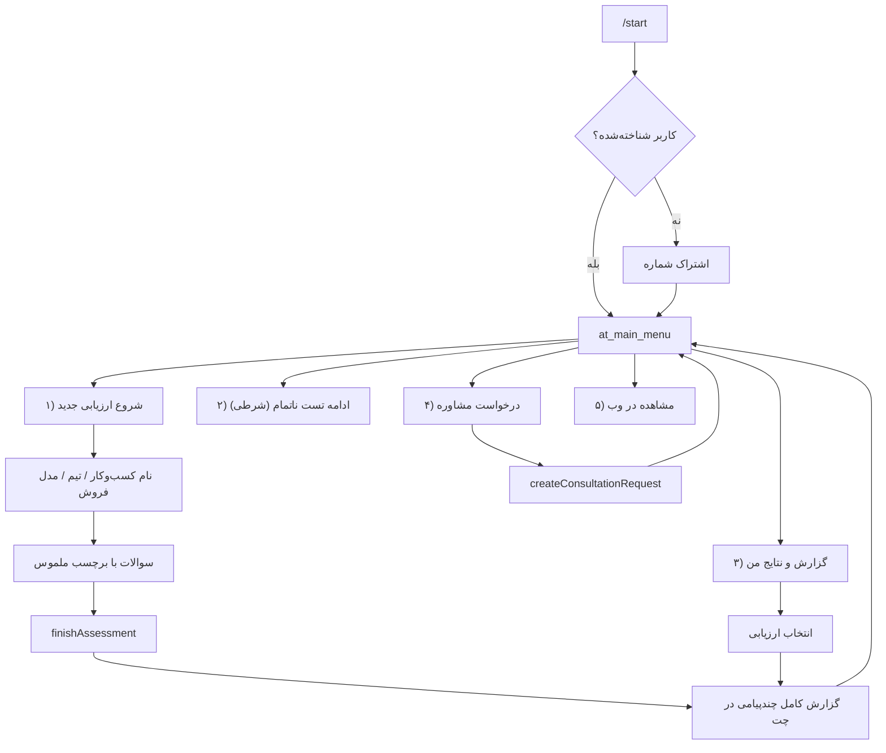

# ربات تلگرام/بله: درگاه کامل خدمات + دکمه‌های ملموس

## هدف

ربات از یک «فقط تست» به **درگاه کامل خدمات** تبدیل شود: منوی منطقی که تست، گزارش در چت، درخواست مشاوره و لینک وب را پوشش می‌دهد. هم‌زمان مشکل خلاصه‌شدن دکمه‌ها در تلگرام با برچسب کوتاه و ملموس (زیر ۶۴ کاراکتر) حل شود.

## اصول ثابت

- **نسخه وب دست‌نخورده:** APIها، DTOهای [`question-bank.service.ts`](src/modules/question-bank/question-bank.service.ts)، صفحات وب و seed هیچ تغییری نمی‌کنند.
- **همه‌چیز در لایه مسنجر:** تغییرها فقط در [`src/modules/messenger/`](src/modules/messenger) + یک migration + داده و اسکریپت backfill.
- **backend منبع حقیقت:** ربات فقط `selectedOptionId` می‌فرستد؛ سرویس‌های موجود ([`saveAnswers`](src/modules/assessment/assessment.service.ts)، [`finishAssessment`](src/modules/assessment/assessment.service.ts)، [`getAssessmentResult`](src/modules/assessment/assessment.service.ts)) بدون تغییر مصرف می‌شوند.
- **محدودیت‌های مسنجر:** متن دکمه inline ≤ ۶۴ کاراکتر؛ متن پیام ≤ ۴۰۹۶ کاراکتر (بودجه امن ۴۰۰۰).

---

## نقشه کلی جریان



---

## بخش ۱ — دکمه‌های ملموس (برچسب کوتاه زیر ۶۴ کاراکتر)

مشکل فعلی: در [`sendCurrentQuestion`](src/modules/messenger/messenger.service.ts) متن کامل و بلند گزینه مستقیم روی دکمه می‌رود و تلگرام آن را خلاصه می‌کند.

راهکار: **برچسب کوتاه روی دکمه + متن کامل گزینه‌ها در بدنه پیام**.

### دیتابیس

ستون nullable روی [`QuestionOption`](prisma/schema.prisma) (فقط مصرف مسنجر):

```prisma
messengerLabel String? @map("messenger_label") @db.VarChar(64)
```

- migration جدید: `20260702120000_messenger_option_labels`
- به هیچ DTO یا پاسخ API وب اضافه نمی‌شود.

### منبع داده برچسب‌ها

فایل [`src/config/model-v1/messenger/option-labels.v1.csv`](src/config/model-v1/messenger/option-labels.v1.csv) با ستون‌های:

- `domain_slug` — مثل `persona`
- `question_display_order` — ۱ تا ۵ داخل دامنه
- `score` — ۰ تا ۳
- `messenger_label` — کوتاه، ملموس، **تضمین‌شده ≤ ۶۴ کاراکتر**

مجموع **۳۲۰ ردیف** (۸۰ سؤال × ۴ گزینه).

نقطه شروع تولید: پارس ستون «تفسیر امتیاز (سؤال)» در [`questions-v1-full.csv`](src/config/model-v1/question-bank/data/questions-v1-full.csv) که برای هر امتیاز یک توصیف کوتاه دارد (مثل «۰ بحرانی: ...»)؛ سپس کوتاه‌سازی دستی به برچسب ملموس.

### backfill

اسکریپت [`scripts/backfill-messenger-labels.ts`](scripts/backfill-messenger-labels.ts):

1. CSV را می‌خواند.
2. با join روی `question_options` → `questions` → `domains` بر اساس (`domain_slug`, `displayOrder`, `score`) هر گزینه را match می‌کند.
3. `messenger_label` را update می‌کند.
4. assert: طول همه ≤ ۶۴ و ۳۲۰/۳۲۰ match؛ در غیر این صورت خطا.

### مصرف در ربات

ماژول [`src/modules/messenger/messenger-labels.repository.ts`](src/modules/messenger/messenger-labels.repository.ts):

- `loadMessengerLabelsByOptionIds(ids)` → `Map<optionId, label>`
- fallback اگر برچسب null بود: کوتاه‌سازی امن `option.text` تا ۶۳ کاراکتر + «…».

در [`sendCurrentQuestion`](src/modules/messenger/messenger.service.ts):

- بدنه پیام: متن سوال + لیست کامل گزینه‌ها به‌صورت شماره‌دار (۰–۳) با متن کامل، تا مفهوم کامل حفظ شود.
- دکمه‌های inline: `messengerLabel` (کوتاه) با `callbackData = optionId` (بدون تغییر منطق ذخیره).

---

## بخش ۲ — منوی اصلی خدمات

### وضعیت‌های جدید

افزودن به [`BotConversationState`](prisma/schema.prisma) (همان migration بخش ۱ یا migration جدا):

| state | نقش |
|-------|-----|
| `at_main_menu` | منوی اصلی بعد از احراز هویت |
| `selecting_report` | انتخاب کدام ارزیابی برای دیدن گزارش |
| `awaiting_consultation_message` | دریافت پیام اختیاری مشاوره |

وضعیت‌های موجود (`awaiting_contact` تا `answering_questions` و `completed`) حفظ می‌شوند.

### تعریف منو

ثابت‌ها و سازندهٔ کیبورد در [`src/modules/messenger/messenger-menu.ts`](src/modules/messenger/messenger-menu.ts):

```
منوی اصلی (inline keyboard):
  1. شروع ارزیابی جدید   → جریان business info → test
  2. ادامه تست ناتمام    → فقط اگر ارزیابی in_progress موجود باشد
  3. گزارش و نتایج من     → selecting_report
  4. درخواست مشاوره       → awaiting_consultation_message
  5. مشاهده در وب         → لینک resultToken (ثانویه)
```

callbackها با prefix مجزا: `menu:new`, `menu:continue`, `menu:reports`, `menu:consult`, `menu:web`.

### احراز هویت و بازگشت کاربر

- **بار اول:** اشتراک شماره از همان [`messenger-auth.service.ts`](src/modules/messenger/messenger-auth.service.ts) → سپس `at_main_menu`.
- **بازدید بعدی:** اگر `userId` روی [`BotConversation`](prisma/schema.prisma) ست بود، مستقیم منو نمایش داده می‌شود (بدون درخواست دوباره شماره).

---

## بخش ۳ — گزارش کامل در چت (بدون وابستگی به لینک)

### Formatter

[`src/modules/messenger/messenger-result.formatter.ts`](src/modules/messenger/messenger-result.formatter.ts):

- ورودی: `AssessmentResultResponse` از [`getAssessmentResult`](src/modules/assessment/assessment.service.ts)
- خروجی: `string[]` — هر عنصر ≤ ۴۰۰۰ کاراکتر

محتوا (هم‌تراز صفحه Result Dashboard):

1. بنر وضعیت (survival) + امتیاز کلی + `overallSummary`
2. گلوگاه‌ها (`bottleneckSummaries`) + تشخیص‌های اصلی
3. Quick Win + اقدامات اصلاحی (`correctiveActions`)
4. امتیاز لایه‌ها (`layerScores`)
5. خلاصه ۱۶ دامنه — یک خط برای هر دامنه: `نام: XX٪ — وضعیت`

Helper مشترک [`src/modules/messenger/bot/send-long-text.ts`](src/modules/messenger/bot/send-long-text.ts): حلقه روی `client.sendMessage` برای ارسال چند پیام.

### جایگزینی completeAssessment

در [`completeAssessment`](src/modules/messenger/messenger.service.ts):

- حذف «لینک گزارش کامل» به‌عنوان خروجی اصلی.
- ارسال پیام(های) formatter مستقیم در چت.
- در پایان بازگشت به `at_main_menu`.
- لینک وب فقط از طریق گزینه ۵ منو در دسترس می‌ماند.

---

## بخش ۴ — گزارش و نتایج من (ارزیابی‌های قبلی)

بدون تغییر API وب، با import مستقیم از ماژول account:

- [`findAssessmentsByUserId(userId)`](src/modules/account/account.repository.ts) → لیست ارزیابی‌ها با `organization` و `overallScore`.
- دکمه‌های inline: «{businessName} — {تاریخ} — {امتیاز}٪» با `callbackData = report:{assessmentId}`.
- انتخاب هر مورد → همان formatter بخش ۳ روی آن ارزیابی (با `resultToken` خودش برای `getAssessmentResult`).
- اگر ارزیابی completed نبود: پیام مناسب و پیشنهاد ادامه تست.

---

## بخش ۵ — درخواست مشاوره در چت

Reuse مستقیم [`createConsultationRequest`](src/modules/consultation/consultation.repository.ts) (نه HTTP، نه token — چون in-process و مالکیت `userId` تأیید شده):

- `name` از `contactFirstName` یا یک پیام متنی.
- `phone` از شماره کاربر.
- `assessmentSessionId` / `reportId` از آخرین ارزیابی completed یا موردی که کاربر انتخاب کرد.
- پیام اختیاری در state `awaiting_consultation_message`.
- پایان: پیام تأیید + بازگشت به منو.

---

## بخش ۶ — اصلاح رفتار `/start` و متن آزاد

| وضعیت | رفتار فعلی (مشکل) | رفتار جدید |
|--------|-------------------|------------|
| `idle` + متن | شروع خودکار تست | نمایش `at_main_menu` |
| `completed` + متن | شروع خودکار تست | نمایش `at_main_menu` |
| وسط تست | — | بدون تغییر |

تغییر در [`handleText`](src/modules/messenger/messenger.service.ts) و [`handleStartCommand`](src/modules/messenger/messenger.service.ts).

---

## بخش ۷ — تست

| فایل | پوشش |
|------|------|
| [`src/tests/messenger/messenger-labels.test.ts`](src/tests/messenger/messenger-labels.test.ts) | fallback کوتاه‌سازی، تضمین ≤ ۶۴ |
| [`src/tests/messenger/messenger-result.formatter.test.ts`](src/tests/messenger/messenger-result.formatter.test.ts) | split زیر ۴۰۹۶ و بخش‌های گزارش |
| [`src/tests/integration/messenger-flow.integration.test.ts`](src/tests/integration/messenger-flow.integration.test.ts) | منو → تست → گزارش در چت + گزینه گزارش قبلی + مشاوره |

---

## استقرار

1. `npm run db:migrate` (لوکال و سرور)
2. `tsx scripts/backfill-messenger-labels.ts`
3. deploy image جدید از مسیر [`scripts/deploy-to-vps.sh`](scripts/deploy-to-vps.sh)

---

## خارج از scope (فاز بعد)

- خروجی PDF در چت
- ویرایش برچسب‌ها از پنل admin
- Web App تلگرام
