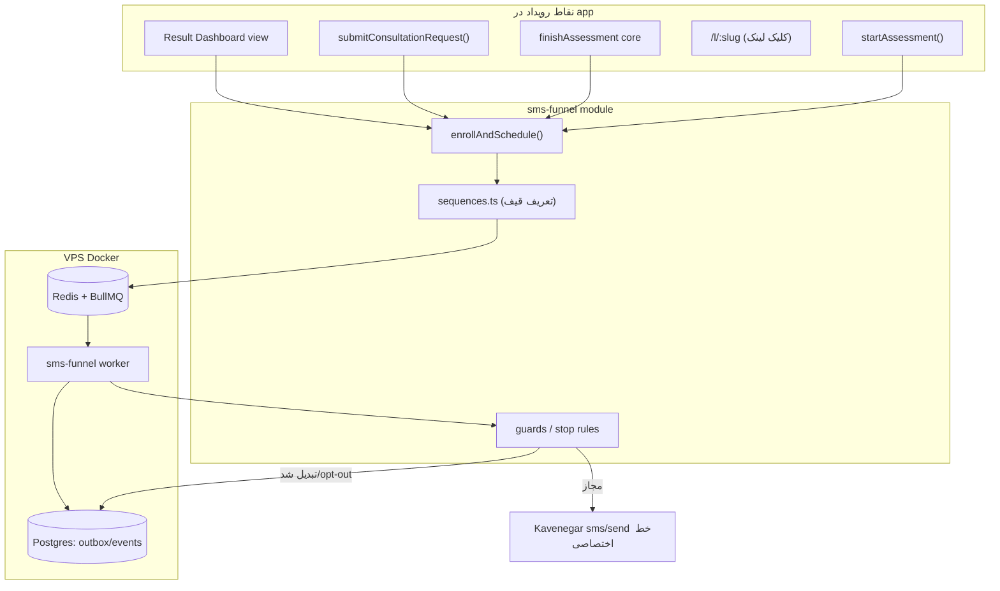

# قیف اتومیشن پیامکی فروش (Sales Health Check)

## هدف و اصول

یک موتور پیامکی رفتاری که کاربر را مرحله‌به‌مرحله در قیف جلو می‌برد، نرخ تبدیل هر مرحله را بالا و ریزش را کم می‌کند. همه پیام‌ها با برندینگ ثابت ارسال می‌شوند تا کاربر بداند از سمت **«سلامت سیستم فروش | جاوید مقدم»** است.

اصول ثابت (هم‌راستا با [ADR 0005](docs/adr/0005-use-modular-monolith.md) و پلن [scale_campaign_readiness](.cursor/plans/scale_campaign_readiness_d9513a78.plan.md)):
- **Modular monolith:** ماژول جدید `src/modules/sms-funnel/` + توسعه `src/modules/auth/sms/`. worker همان image با CMD متفاوت.
- **Route نازک:** منطق در ماژول؛ route فقط auth/validation.
- **Feature flag:** کل قیف پشت `SMS_FUNNEL_ENABLED`؛ در dev بدون Redis/خط پیامک خاموش و لاگ‌محور.
- **هسته دست‌نخورده:** scoring/diagnosis/report تغییر نمی‌کنند؛ فقط hook برای enroll اضافه می‌شود.

## وضعیت فعلی (از بررسی کد)
- پیامک فقط OTP است: [`kavenegar.ts`](src/modules/auth/sms/kavenegar.ts) با `verify/lookup.json`؛ متن آزاد وجود ندارد.
- هیچ job/queue/outbox نداریم؛ ردیابی «گزارش دیده شد / کلیک لینک» ثبت نمی‌شود.
- مدل داده برای hook مناسب است: `AssessmentSession.status` (`started/in_progress/completed/abandoned`) + `completedAt` + `resultToken`، و `ConsultationRequest` با `LeadStatus`.

## معماری کلی



الگو: در هر رویداد، پیام‌های تاخیری آن sequence به‌صورت BullMQ delayed job زمان‌بندی می‌شوند. هر job هنگام اجرا **guardها را دوباره ارزیابی می‌کند** (opt-out، تبدیل رخ داده؟، enrollment هنوز active؟) و یا می‌فرستد یا skip می‌کند. یک cron ایمنی (reconciliation) هم برای safety-net.

## بخش ۱ — مدل داده (Prisma migration)

فایل [`prisma/schema.prisma`](prisma/schema.prisma) + migration جدید:

- `SmsMessage` (outbox/audit): `phone, body, status(pending|sent|failed|canceled|skipped), sequenceKey, stepKey, enrollmentId, dedupeKey @unique, providerMessageId, scheduledFor, sentAt, error, createdAt`. ایندکس `[status, scheduledFor]` و `[phone]`. `dedupeKey` از duplicate جلوگیری می‌کند.
- `FunnelEnrollment`: `userId, assessmentSessionId?, sequenceKey, currentStep, status(active|completed|stopped|converted), scoreBand(low|medium|high)?, lastEventAt`. یکتا: `[userId, sequenceKey, assessmentSessionId]`.
- `FunnelEvent`: `userId?, assessmentSessionId?, type(report_viewed|link_clicked|cta_clicked|consultation_started|sms_sent|opt_out), metadata Json?, occurredAt`. این کمبود tracking فعلی را پر می‌کند.
- `ShortLink`: `slug @id، targetUrl، userId?، assessmentSessionId?، purpose(result|consultation)، clickCount، createdAt`.
- `SmsOptOut`: `phone @id، createdAt` (opt-out بر اساس شماره چون شماره lead ممکن است با `User.phone` فرق کند).

enumها: `SmsStatus`, `EnrollmentStatus`, `ScoreBand`, `FunnelEventType`.

## بخش ۲ — لایه پیامک متن‌آزاد + برندینگ

- توسعه [`sms.types.ts`](src/modules/auth/sms/sms.types.ts): افزودن `sendMessage(phone: string, message: string): Promise<{ providerMessageId?: string }>` به `SmsSender`.
- در [`kavenegar.ts`](src/modules/auth/sms/kavenegar.ts): پیاده‌سازی `sendMessage` با `GET /v1/{apiKey}/sms/send.json?receptor=&sender={line}&message=`؛ خط اختصاصی از env جدید `KAVENEGAR_SENDER_LINE`. dev sender فقط console.log.
- env جدید در [`src/lib/env.ts`](src/lib/env.ts): `kavenegarSenderLine`, `smsFunnelEnabled`, `smsQuietHoursStart/End`, `appBaseUrl` (موجود) برای لینک‌ها.
- **برندینگ helper** `src/modules/sms-funnel/branding.ts`: امضای ثابت `— سلامت سیستم فروش | جاوید مقدم` که به هر پیام append می‌شود، به‌همراه ساخت short link. توجه: پیام فارسی unicode ~۷۰ کاراکتر/سگمنت است؛ متن‌ها فشرده و لینک‌ها کوتاه نگه داشته می‌شوند.

## بخش ۳ — ردیابی رویداد و لینک کوتاه (پایه شاخه‌بندی)

بدون این، اتومیشن کور است. حداقل tracking لازم:
- Route جدید [`src/app/l/[slug]/route.ts`](src/app/l/[slug]/route.ts): ثبت `FunnelEvent(link_clicked)` + افزایش `clickCount` سپس 302 به `targetUrl`. این «باز کردن لینک» و «گزارش دیده شد» (اگر لینک به result باشد) را می‌دهد.
- «report_viewed»: علاوه بر کلیک، یک view event سبک هنگام mount شدن Result Dashboard.
- «consultation_started»: event هنگام باز شدن فرم/صفحه درخواست تماس با token.
- «تماس ثبت شد» = همان ردیف `ConsultationRequest` (موجود).

## بخش ۴ — موتور قیف (sequences + scheduler + worker)

ماژول جدید `src/modules/sms-funnel/`:
- `sequences.ts`: تعریف اعلامی هر ۶ مرحله قیف (کلید، steps با delay و متن‌ساز و guard).
- `enrollment.service.ts`: `enrollAndSchedule(userId, sequenceKey, ctx)` — ساخت/به‌روزرسانی `FunnelEnrollment` + enqueue کردن BullMQ delayed job برای هر step با `dedupeKey`.
- `sms-funnel.queue.ts`: صف BullMQ `sms-funnel` (روی همان Redis پلن scale، `src/lib/redis.ts`).
- `guards.ts`: قوانین توقف/ارزیابی مجدد قبل از هر ارسال.
- worker جدید [`scripts/sms-funnel-worker.ts`](scripts/sms-funnel-worker.ts): پردازش job، اجرای guard، ارسال از طریق `SmsSender.sendMessage`، نوشتن `SmsMessage` و `FunnelEvent(sms_sent)`.
- cron ایمنی (reconciliation) اختیاری: اسکن enrollmentهای active جامانده.

hook کردن enroll (تغییر حداقلی، غیرمخرب):
- [`assessment.service.ts`](src/modules/assessment/assessment.service.ts) `startAssessment` → sequence «شروع/نیمه‌کاره».
- finish core (`persistAssessmentResults`) → sequence «گزارش آماده → مشاهده → تماس» + تعیین `scoreBand` از `overallScore` + توقف sequence نیمه‌کاره.
- [`consultation.service.ts`](src/modules/consultation/consultation.service.ts) `submitConsultationRequest` → sequence «تایید/یادآوری تماس» + توقف sequenceهای nurture.
- کلیک لینک consultation بدون ثبت فرم → شاخه «کلیک کرده ولی فرم را کامل نکرده».

## بخش ۵ — کاتالوگ کامل پیام‌ها (متن دقیق)

قواعد مشترک همه پیام‌ها:
- امضای برندینگ ثابت در انتهای هر پیام: `— سلامت سیستم فروش | جاوید مقدم`
- `[link]` = short link رهگیری‌شده (`/l/{slug}`) که به صفحه مربوطه redirect می‌شود.
- هر پیام یک `stepKey` یکتا دارد (مبنای `dedupeKey`).
- زمان‌بندی از لحظه تریگر همان sequence محاسبه می‌شود.
- متن‌ها عمداً فشرده‌اند (پیام فارسی ~۷۰ کاراکتر/سگمنت)؛ لینک کوتاه و امضا در بودجه لحاظ شده.

هر پیام در قالب زیر ساخته می‌شود:
```
{body}
{link در صورت وجود}
— سلامت سیستم فروش | جاوید مقدم
```

### مرحله ۱ — شروع Health Check (`seq_start`)
تریگر: کاربر شماره داده / احراز شده ولی هنوز تستی نساخته یا شروع نکرده. توقف: به‌محض ساخته‌شدن یا شروع تست.

- **`S1-1` فوری**
  > سلام، تست سلامت سیستم فروش شما آماده است. با پاسخ به چند سوال کوتاه، گلوگاه‌های اصلی مسیر فروش‌تان مشخص می‌شود: [link]
- **`S1-2` بعد از ۳ ساعت**
  > هنوز گزارش سلامت سیستم فروش شما تکمیل نشده. کمتر از چند دقیقه زمان می‌برد و نشان می‌دهد کجای قیف فروش بیشترین ریزش را دارید: [link]
- **`S1-3` بعد از ۲۴ ساعت**
  > اگر می‌خواهید بدانید چرا بخشی از لیدها به مشتری تبدیل نمی‌شوند، تست سلامت سیستم فروش را از اینجا ادامه دهید: [link]

### مرحله ۲ — نیمه‌کاره‌ها (`seq_incomplete`)
تریگر: `AssessmentSession.status = in_progress` و کامل‌نشده. توقف: `status = completed`.

- **`S2-1` بعد از ۴۵ دقیقه**
  > فقط چند سوال تا آماده شدن گزارش فروش شما باقی مانده. ادامه دهید تا نقاط ضعف و فرصت‌های رشد مشخص شود: [link]
- **`S2-2` بعد از ۲۴ ساعت**
  > گزارش سلامت سیستم فروش شما نیمه‌کاره مانده. با تکمیل آن می‌بینید کدام بخش فروش بیشترین اثر را روی رشد درآمد دارد: [link]
- **`S2-3` بعد از ۳ روز (پیام آخر)**
  > اگر هنوز فرصت نکرده‌اید، لینک ادامه تست فعال است. هر زمان تکمیل کنید، گزارش اختصاصی فروش شما آماده می‌شود: [link]

### مرحله ۳ — گزارش آماده شده (`seq_report_ready`)
تریگر: `status = completed` / `completedAt`. توقف `S3-2`: ثبت `report_viewed` یا `ConsultationRequest`.

- **`S3-1` فوری بعد از تکمیل**
  > گزارش سلامت سیستم فروش شما آماده شد. چند گلوگاه اصلی در مسیر فروش‌تان مشخص شده. مشاهده گزارش: [link]
- **`S3-2` بعد از ۲۴ ساعت (اگر گزارش دیده نشد)**
  > گزارش فروش شما آماده است اما هنوز مشاهده نشده. پیشنهاد می‌کنیم قبل از هر تصمیمی برای رشد فروش، این نتیجه را ببینید: [link]

### مرحله ۴ — گزارش دیده، تماس نداده (`seq_nurture`)
تریگر: `report_viewed` ثبت شد و `ConsultationRequest` وجود ندارد. توقف: ثبت درخواست تماس (تبدیل). این مرحله نسخه‌های scoreBand دارد (بخش ۶).

- **`S4-1` بعد از ۲ ساعت**
  > بر اساس پاسخ‌های شما، چند نقطه قابل بهبود در مسیر فروش مشخص شده. اگر بخواهید، در یک تماس کوتاه بررسی می‌کنیم کدام مورد اولویت بالاتری دارد: [link]
- **`S4-2` بعد از ۲۴ ساعت**
  > خیلی از ریزش‌های فروش با اصلاح چند نقطه کلیدی در پیگیری، پیشنهاد یا تبدیل لید بهتر می‌شوند. برای بررسی گزارش خودتان، زمان تماس را انتخاب کنید: [link]
- **`S4-3` بعد از ۳ روز**
  > اگر هدف‌تان افزایش نرخ تبدیل فروش است، می‌توانیم گزارش سلامت سیستم فروش شما را در یک جلسه کوتاه تحلیل کنیم و مسیر اقدام بدهیم: [link]
- **`S4-4` بعد از ۷ روز (پیام آخر)**
  > اگر الان زمان مناسبی نیست مشکلی نیست. لینک گزارش و درخواست تماس شما فعال می‌ماند و هر زمان آماده بودید می‌توانید اقدام کنید: [link]

### مرحله ۵ — کلیک کرده، فرم تماس ناتمام (`seq_form_abandon`)
تریگر: `consultation_started` ثبت شد ولی `ConsultationRequest` submit نشد. توقف: submit شدن فرم.

- **`S5-1` بعد از ۴۵ دقیقه**
  > درخواست تماس شما هنوز کامل نشده. برای هماهنگی بررسی گزارش فروش‌تان فقط انتخاب زمان باقی مانده: [link]
- **`S5-2` بعد از ۲۴ ساعت**
  > برای تحلیل گزارش سلامت سیستم فروش شما می‌توانید زمان تماس را از این لینک انتخاب کنید. جلسه کوتاه و متمرکز روی اولویت‌های فروش شماست: [link]

### مرحله ۶ — درخواست تماس ثبت شده (`seq_call_scheduled`)
تریگر: `ConsultationRequest` ساخته شد. زمان‌بندی یادآوری‌ها بر اساس زمان تماس هماهنگ‌شده (اگر ثبت شود؛ در غیر این صورت فقط `S6-1`).

- **`S6-1` تایید فوری (بدون لینک)**
  > درخواست تماس شما ثبت شد. در زمان انتخاب‌شده، گزارش سلامت سیستم فروش‌تان را بررسی می‌کنیم و اولویت‌های بهبود را مشخص می‌کنیم.
- **`S6-2` ۲۴ ساعت قبل از تماس (بدون لینک)**
  > یادآوری: فردا زمان بررسی گزارش سلامت سیستم فروش شماست. اگر نکته خاصی مدنظر دارید، آماده داشته باشید.
- **`S6-3` ۲ ساعت قبل از تماس (بدون لینک)**
  > یادآوری کوتاه: تا ساعتی دیگر تماس بررسی گزارش فروش شما انجام می‌شود.
- **`S6-4` در صورت no-show**
  > به نظر می‌رسد تماس امروز انجام نشد. اگر هنوز مایلید گزارش فروش‌تان بررسی شود، می‌توانید زمان جدید انتخاب کنید: [link]

## بخش ۶ — نسخه‌های scoreBand (override متن)

`scoreBand` هنگام finish از `overallScore` تعیین و روی `FunnelEnrollment` ذخیره می‌شود. متن‌ساز step اگر برای آن band نسخه override داشته باشد آن را جایگزین می‌کند، وگرنه متن پایه بخش ۵ استفاده می‌شود. Override اصلی روی نقطه تبدیل (`S3-1`, `S4-1`, `S4-2`) است.

### امتیاز پایین (`low`) — لحن فوری و مسئله‌محور
- **`S3-1` (low)**
  > گزارش شما نشان می‌دهد چند نقطه در قیف فروش می‌تواند باعث ریزش جدی لیدها شود. همین حالا نتیجه را ببینید: [link]
- **`S4-1` (low)**
  > گزارش شما نشان می‌دهد چند نقطه در قیف فروش می‌تواند باعث ریزش جدی لیدها شود. پیشنهاد می‌کنیم در یک تماس کوتاه اولویت‌های اصلاح را مشخص کنیم: [link]
- **`S4-2` (low)**
  > تعویق اصلاح این گلوگاه‌ها معمولا یعنی ادامه ریزش لید و فروش. برای بررسی سریع اولویت‌ها، زمان تماس را انتخاب کنید: [link]

### امتیاز متوسط (`medium`) — لحن بهینه‌سازی و نرخ تبدیل
- **`S4-1` (medium)**
  > وضعیت فروش شما قابل بهبود است و چند فرصت مشخص برای افزایش نرخ تبدیل دیده می‌شود. برای بررسی مسیر بهبود، درخواست تماس ثبت کنید: [link]
- **`S4-2` (medium)**
  > با اصلاح چند نقطه کلیدی می‌توانید نرخ تبدیل فروش‌تان را محسوس بالا ببرید. برای تحلیل گزارش، زمان تماس را انتخاب کنید: [link]

### امتیاز بالا (`high`) — لحن رشد و scale
- **`S4-1` (high)**
  > گزارش شما نشان می‌دهد پایه فروش نسبتا خوبی دارید. حالا مسئله اصلی می‌تواند بهینه‌سازی و مقیاس‌پذیری باشد. برای بررسی فرصت‌های رشد: [link]
- **`S4-2` (high)**
  > برای رشد پایدار، قدم بعدی معمولا scale فرایند فروش است. می‌توانیم در یک جلسه کوتاه فرصت‌های رشد گزارش شما را مرور کنیم: [link]

## بخش ۷ — قوانین توقف و انطباق (compliance)

در `guards.ts` قبل از هر ارسال:
- ثبت `ConsultationRequest` → توقف کامل sequenceهای nurture (`status=converted`).
- کلیک لینک → ورود به شاخه رفتاری مناسب.
- سقف ۴ پیام بدون واکنش → `status=stopped` (dormant).
- بازکردن دوباره گزارش → فعال‌سازی مجدد sequence تماس.
- `SmsOptOut` موجود یا کلمه «لغو» → توقف کامل + ثبت `FunnelEvent(opt_out)`.
- **Quiet hours:** ارسال خارج از ساعت مجاز (مثلاً ۹ صبح–۹ شب) به ابتدای بازه بعدی موکول شود.
- **Dedupe:** `dedupeKey` یکتا مانع ارسال دوباره یک step.

## بخش ۸ — نمایش در پنل ادمین (حداقلی)

توسعه ماژول [`admin`](src/modules/admin/admin.service.ts): صفحه‌ای برای دیدن پیام‌های زمان‌بندی‌شده/ارسال‌شده، opt-outها، و متریک قیف پیامکی (نرخ ارسال، کلیک، تبدیل به تماس). می‌تواند فاز دوم باشد.

## بخش ۹ — تست
- unit: `sequences` (delay/guard/متن + branding + طول)، `guards` (توقف/تبدیل/opt-out/quiet hours)، Kavenegar `sms/send` (mock fetch).
- integration: enroll → worker inline → ارسال؛ سناریو توقف بعد از ثبت تماس؛ dedupe.
- تست‌های موجود auth/assessment دست‌نخورده بمانند.

## بخش ۱۰ — استقرار
- وابسته به infra پلن scale: Redis + worker container (`docker-compose.nginx.yml` / `prod`).
- env جدید: `SMS_FUNNEL_ENABLED`, `KAVENEGAR_SENDER_LINE`, `SMS_QUIET_HOURS_*`.
- worker جدید `sms-funnel-worker` (همان image، CMD متفاوت).
- migration روی سرور؛ deploy از [`scripts/deploy-to-vps.sh`](scripts/deploy-to-vps.sh).
- **نکته عملیاتی:** ارسال انبوه با لینک در ایران به خط خدماتی مصوب و گاهی دامنه whitelist‌شده نیاز دارد؛ قبل از launch با کاوه‌نگار تایید شود.

## MVP پیشنهادی (فاز اول)
۴ مسیر اول کافی است تا با داده واقعی متن‌ها/زمان‌ها A/B شوند:
1. مدل داده + لایه sms/send + برندینگ (بخش ۱،۲)
2. tracking + short link (بخش ۳)
3. موتور + worker + hookهای finish و consultation (بخش ۴)
4. sequenceهای «نیمه‌کاره»، «گزارش دیده بدون تماس»، «فرم ناتمام»، «یادآوری تماس ثبت‌شده» + قوانین توقف/opt-out (بخش ۵،۷)

بخش ۶ (score-band کامل)، بخش ۸ (ادمین)، و cron reconciliation در فاز دوم.

## خارج از scope (فاز بعد)
- شخصی‌سازی بر اساس صنعت/اندازه تیم/نوع گلوگاه.
- کانال‌های دیگر (واتس‌اپ/ایمیل) — این پلن فقط پیامک است.
- A/B testing framework خودکار.